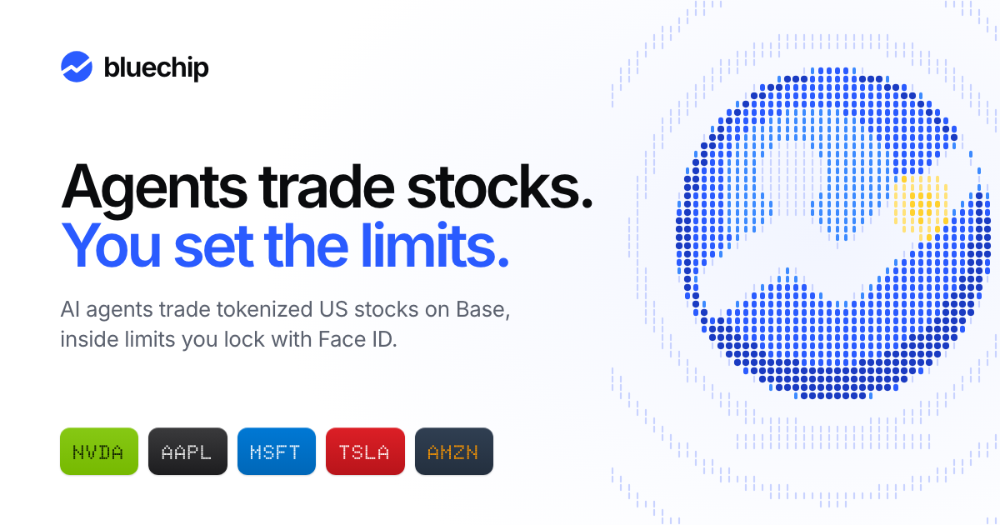
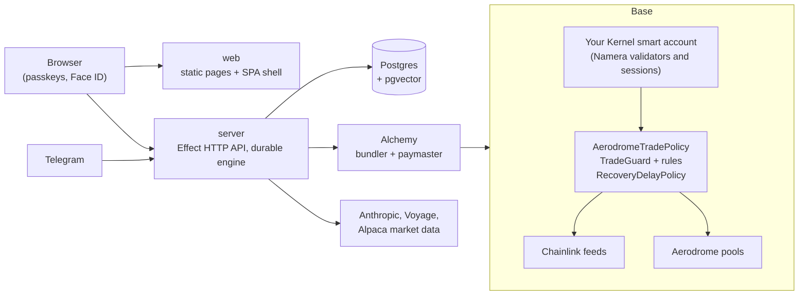

# bluechip

You and AI agents trading tokenized US stocks on Base, from your own smart account, inside limits that Base enforces.

[](https://github.com/envoy1084/bluechip/actions/workflows/ci.yml)
[](./LICENSE)



**Try it:** the open beta runs on paper money at [paper.bluechip.markets](https://paper.bluechip.markets): test money
on Base Sepolia, nothing real. The site is [bluechip.markets](https://bluechip.markets), and the
[help center](https://bluechip.markets/help) explains every screen in plain words.

## What it is

bluechip is a trading app for Coinbase's tokenized US stocks on Base, priced by Chainlink and traded against USDC on
Aerodrome. You can trade yourself, or hand the work to agents that trade for you.

- **Your own account.** A smart account on Base (Kernel, through Namera) owned by your passkeys. No password, no seed
  phrase, no email: you sign with Face ID, your fingerprint or your device's screen lock, and the key never leaves
  your device.
- **Agents with limits that live onchain.** An agent is a session key on your account carrying policies: the stocks
  it may trade, its daily budget, its largest trade, how much of one stock you may hold, the cash it must leave, a
  stop-loss floor, a slippage budget, trades and gas per day. Base checks every operation it sends against them, so
  nothing bluechip's server does can take an agent past them. An agent can never send money out of your account or
  change its own limits; changing them takes your Face ID.
- **Automations.** A trigger (a schedule, a price move or cross, portfolio drift, news), conditions and an action
  (buy, sell, rebalance, notify you or ask you first), saved for you or for an agent. Each run ends as trades that go through the same
  checks as any other.
- **The assistant**, in the web app and on Telegram. It reads your portfolio, explains a refusal, drafts an agent or
  an automation and proposes trades. What it proposes is a typed card you confirm; anything that needs a signature
  links back into the app for your Face ID.
- **Recovery with a 48-hour onchain delay.** A recovery key is a second passkey that can only ask to replace your
  owners. The request waits 48 hours onchain, is announced on every channel, and any signed-in device or Telegram can
  cancel it.
- **Fair prices.** Every trade is checked against Chainlink's price for its stock; one too far from it doesn't
  happen.

bluechip isn't available to US citizens or residents, because Coinbase's tokenized stocks aren't offered to them.

## How it works



The web app is a static build: prerendered public pages and a single-page shell. It calls the server's API on its own
domain and reads the chain through the server's `/api/rpc`. The server runs the API, the Telegram bot and Effect's
cluster engine, where every cron, workflow and wait (a receipt, an approval, a recovery's 48 hours) is durable, so a
restart never loses or repeats a send.

Every trade, yours or an agent's, is an **intent**: who asked, who signs, the trade, why, what was decided and how it
ended. An agent's intent goes through one path, one account at a time:

1. **Ask.** You, an automation, the assistant or a chat creates the intent.
2. **Simulate as the agent.** bluechip simulates the operation as the agent's session key and reads the chain's
   answer. It never keeps a TypeScript copy of a contract's rule.
3. **Decide.** It passes and is sent by the agent's key. Or it is over the agent's largest trade and waits for your
   approval. Or a policy refuses it, and it is blocked with that policy in words ("Blocked by Max in one stock"). Or
   it waits for fresh prices, gas or the end of the day's last minute.
4. **Settle.** The fill goes to the ledger with its costs (the pool's fee, slippage against Chainlink, gas), and your
   positions and results are rebuilt from it.

The onchain side lives in `contracts/`: `AerodromeTradePolicy` validates what an agent may call, `TradeGuard` measures
what moved after the swap, values the portfolio and runs the session's rule contracts (`contracts/src/rules/`), and
`RecoveryDelayPolicy` makes a recovery key's owner changes wait 48 hours.

## Repository layout

| Path              | What it is                                                                                        |
| ----------------- | ------------------------------------------------------------------------------------------------- |
| `apps/web`        | The TanStack Start web app: landing, help center and the app itself, feature-first                |
| `apps/server`     | The Effect HTTP server: API, durable workflows and crons, Telegram bot, Drizzle tables            |
| `apps/uikit`      | A single-page app showing every `@bluechip/ui` component (port 4000)                              |
| `apps/e2e`        | The browser end-to-end suite (Playwright) against the real server and its own devnet              |
| `packages/domain` | Shared ids, errors, events, the policy and automation catalogs and the HTTP API contract          |
| `packages/chain`  | Base from Effect: the viem client, addresses, ABIs, sessions, owners, recovery and simulation     |
| `packages/devnet` | A local Base for tests: Anvil and Alto per Vitest worker, from a captured state of a fork         |
| `packages/ui`     | The design system: Tailwind v4 theme, components on Base UI, motion and illustrations             |
| `contracts`       | bluechip's onchain policies and rules in Solidity (Foundry), and paper money's exchange and feeds |
| `content/help`    | The help center's articles, one Markdown file each, also searched by the assistant                |
| `scripts`         | The repository's tooling, one Effect CLI (`node scripts/bin.ts <command>`)                        |
| `deploy`          | Compose files and the guide for deploying on Dokploy                                              |

[AGENTS.md](./AGENTS.md) is the full guide to the codebase: its conventions, and how to add a policy, an automation
trigger, a notification or a chat platform.

## Tech stack

- **Language:** TypeScript 7 (tsgo) with the Effect language service, and Effect v4 throughout, front to back.
- **Web:** TanStack Start (static prerender and an SPA shell), TanStack Router, Tailwind v4 and a design system on
  Base UI.
- **Server:** Effect's HTTP API, Drizzle ORM on Postgres with pgvector, Effect's cluster engine for durable
  workflows, Effect's AI modules for the assistant (Anthropic models, Voyage embeddings), Alpaca for market data.
- **Chain:** viem, Namera v2 on a Kernel smart account, ERC-4337 through Alto locally and Alchemy on paper money and
  production, Chainlink feeds and Aerodrome pools.
- **Contracts:** Solidity with Foundry, dependencies through Soldeer.
- **Quality:** Vitest (with `@effect/vitest`, browser mode for the UI), Playwright, dprint, oxlint with Effect's
  rules, lefthook and commitlint.
- **Observability:** Axiom (traces, logs, metrics) and PostHog, on paper money and production only.

## Getting started

### Prerequisites

- Node.js 26 (`.node-version`) and pnpm 12 (`packageManager` in `package.json`)
- Docker, for Postgres
- [Foundry](https://getfoundry.sh), for the contracts and for Anvil, which runs the local chain and the chain tests

### Install and configure

```sh
pnpm install
```

`pnpm install` also installs the Git hooks and patches TypeScript with the Effect language service. Then copy each
`.env.example` to `.env.local` (never committed): the root one (Docker Compose's fork RPC, only for `--fork` and
`pnpm devnet:capture`), [`apps/server/.env.example`](./apps/server/.env.example) and
[`apps/web/.env.example`](./apps/web/.env.example). In the server's, the ones that matter:

- `AGENT_KEY_ENCRYPTION_KEY`, required: `openssl rand -base64 32`.
- Web push keys: `node scripts/bin.ts vapid --env apps/server/.env.local` writes them.
- Optional: `TELEGRAM_BOT_TOKEN` and `TELEGRAM_BOT_USERNAME` for the bot (polling in development),
  `ANTHROPIC_API_KEY` for the assistant, `ALPACA_API_KEY_ID` and `ALPACA_API_SECRET_KEY` for live market data,
  `VOYAGE_API_KEY` for the assistant's recall and help search.

### Run it

```sh
pnpm dev
```

One terminal starts Postgres, the local chain (the devnet on Anvil, port 8545; its feeds and pools follow the
server's market prices every 15 seconds, and its state carries over between runs), the Alto bundler (4337), the
migrations, then the server (8080), the web app (3000) and the component kit (4000). Ctrl+C stops everything, and
`pnpm dev:stop` stops anything left running (`--all` stops Postgres too). `pnpm dev --fork` uses an Anvil fork of Base
through your RPC instead, `--reset-chain` starts the chain again from the capture, and `--no-chain` or `--no-uikit`
skip parts.

To review the UI without a backend, `pnpm dev:preview` runs only the web app and opens `/home?preview=typical`: the
app talks to a mock of the API served in the browser from a made-up world (`?preview=newPerson`, `typical` or
`heavy`), with fake Face ID. Its god mode panel (the pill in the corner, or ⌘.) switches accounts, puts agents,
trades, automations and chats in any state, and slows, hangs or breaks any area's requests. It loads in development
only and never ships.

To drive the real app without Touch ID, add `?softPasskey` in development: a real P-256 authenticator in the page
answers every WebAuthn prompt, and the server and the chain verify its signatures like any passkey's. Its keys live in
local storage until `?softPasskey=off`.

### Test

| Command                | What it does                                                                     |
| ---------------------- | -------------------------------------------------------------------------------- |
| `pnpm check`           | Everything CI runs: format, lint, types, import cycles, contracts and every test |
| `pnpm test`            | Every Vitest project once (`pnpm test <file>` for one, `test:watch` to watch)    |
| `pnpm test:fast`       | The tests with no devnet or browser, run before every push                       |
| `pnpm typecheck`       | Type-check everything with the Effect diagnostics                                |
| `pnpm lint:fix`        | oxlint's fixes; `pnpm lint` also checks which way imports point                  |
| `pnpm format`          | Format with dprint                                                               |
| `pnpm test:e2e`        | The browser suite on its own stack (about 10 minutes, not in `check`)            |
| `pnpm contracts:test`  | Format check, lints and Foundry tests of `contracts/`                            |
| `pnpm contracts:build` | Build the contracts and regenerate their addresses and ABIs for TypeScript       |
| `pnpm build`           | `tsc -b`, then each package's build                                              |

Tests need only Postgres: server tests use their own `bluechip_test` database, and chain tests run on the devnet, a
local Base with every contract bluechip uses at its real address, so they need no RPC. A change to a contract's
bytecode moves its address: run `pnpm contracts:build`, then `pnpm devnet:capture` (needs `BASE_FORK_RPC_URL`), and
update the gas snapshot (`node scripts/bin.ts contracts snapshot`).

## Networks

| Network    | Chain        | What it is                                                                                                                                                                                 |
| ---------- | ------------ | ------------------------------------------------------------------------------------------------------------------------------------------------------------------------------------------ |
| Local      | Devnet       | Anvil from a captured state of Base, with every contract at its real address and settable price feeds (`pnpm dev`)                                                                         |
| Paper      | Base Sepolia | The open beta: a test USDC faucet ($1,000 a tap, up to $10,000 a day), test stocks on bluechip's paper exchange, price feeds written by an operator from live market prices, gas sponsored |
| Production | Base         | Coinbase's tokenized stocks, Chainlink's feeds and Aerodrome's pools; opens after an audit                                                                                                 |

Preview mode is none of these: it is a mock of the API in the browser, for reviewing screens.

## Security model

- **An agent can never** send money out of your account, trade a stock you didn't allow, go past its limits or
  change them. Those limits are its session's policies, checked by Base on every operation.
- **Only your passkeys move money or change limits.** Locking, changing, renewing or removing an agent, your own
  trades and withdrawals all take your Face ID.
- **Keys are sealed.** Agents' session keys are encrypted at rest (`AGENT_KEY_ENCRYPTION_KEY`); passkeys never leave
  your device.
- **A compromised server** could make an agent trade within its limits and could cancel a pending recovery. It can
  never move money past an agent's limits, start a recovery or speed one up: the 48-hour delay is enforced onchain by
  `RecoveryDelayPolicy`, and bluechip's own guard key may only cancel.
- **Not audited yet.** The contracts have Foundry tests, a frozen fixture of the rules' behaviour and a gas snapshot,
  but no external audit. That is why the open beta runs on paper money.

To report a vulnerability, see [SECURITY.md](./SECURITY.md).

## Deploying

Each deployment is two images built from this repository: **web**, the static build served by Caddy, and **server**,
the API and durable engine, which migrates its database on start, beside Postgres with pgvector. Paper money and
production are two Dokploy projects deploying the same `deploy/compose.yaml` with their own environment, and until
mainnet `bluechip.markets` serves the landing alone. [deploy/README.md](./deploy/README.md) covers DNS, every
environment variable, domains, Telegram's webhook, backups and operations.

## Status

Open beta on paper money (Base Sepolia). Mainnet on Base follows an external audit of the contracts. Paper money may
be reset.

## Contributing

Bug reports, fixes and ideas are welcome. Read [CONTRIBUTING.md](./CONTRIBUTING.md) for the workflow and
[AGENTS.md](./AGENTS.md) for the conventions.

## License

[Apache-2.0](./LICENSE)
